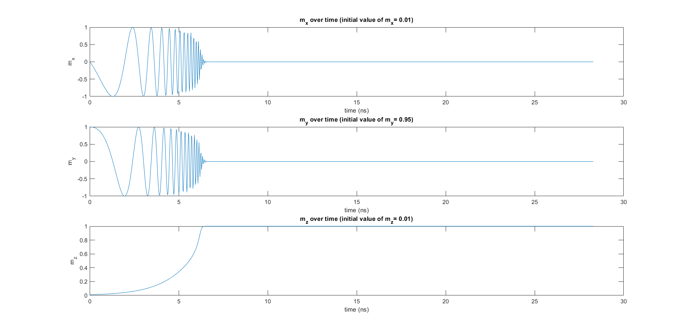
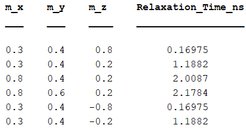
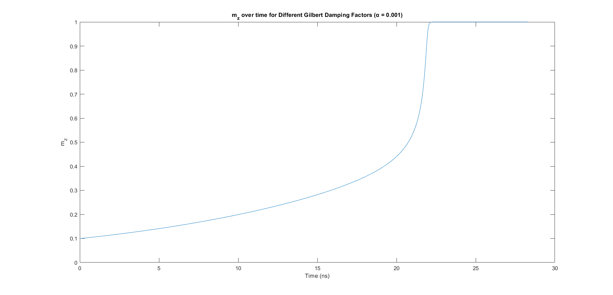
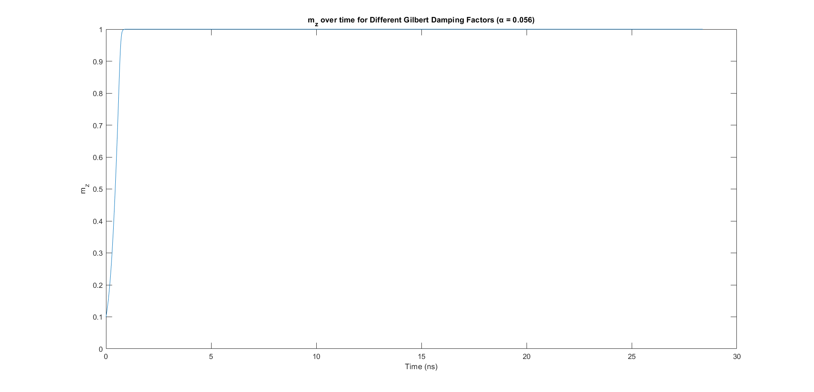
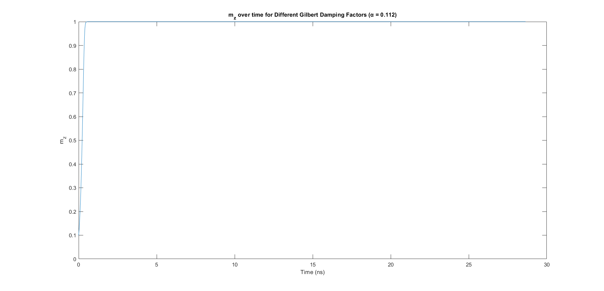
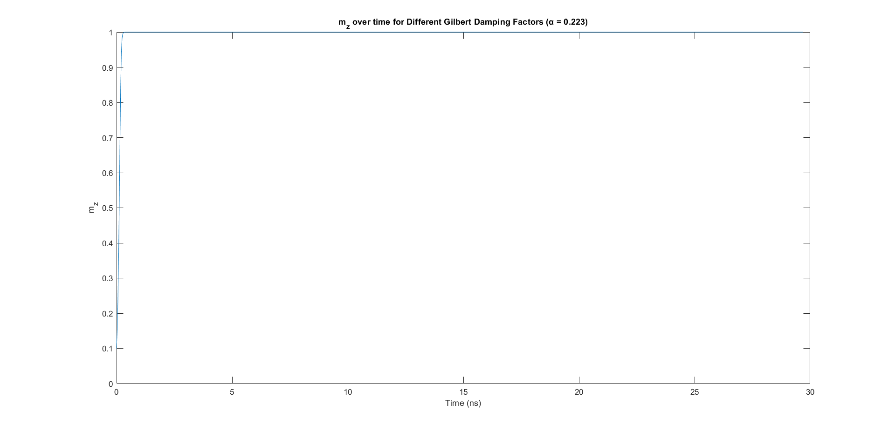
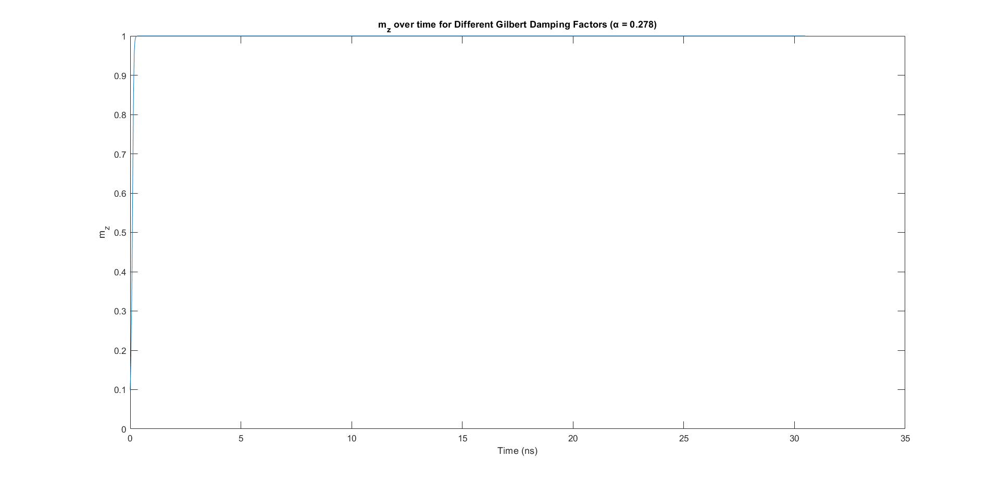
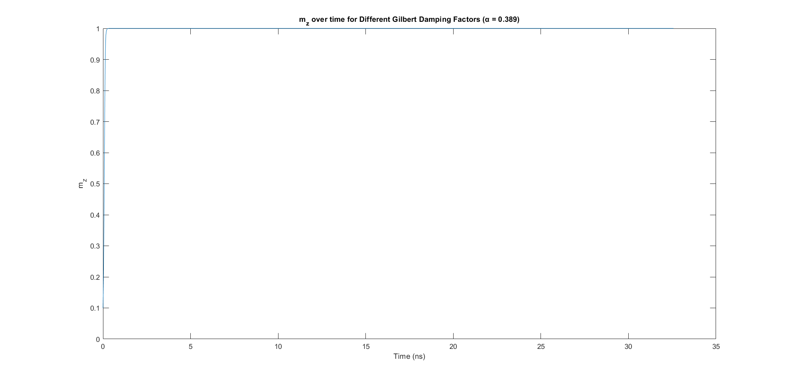
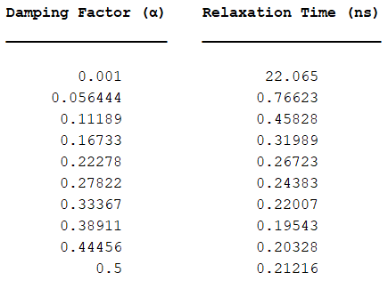

# Magnetization Dynamics Simulation Using RK4

A MATLAB based numerical simulation of magnetization dynamics using the fourth-order Runge–Kutta (RK4) method, with analysis of pure relaxation, initial magnetization orientation and the effect of Gilbert damping on relaxation time.

## 1. Project Overview

This project investigates the numerical simulation of magnetization dynamics in a nanomagnet using the Landau-Lifshitz-Gilbert (LLG) framework.

Magnetization dynamics describe how the magnetization vector of a magnetic material evolves with time under the influence of effective magnetic fields and damping. In this project, the magnetization dynamics are simulated numerically in MATLAB using a manually implemented **fourth-order Runge–Kutta (RK4) method** rather than MATLAB's built-in `ode45` solver.

The project consists of three main tasks:

1. Simulating pure magnetization relaxation using RK4.
2. Investigating how the initial magnetization position affects relaxation time.
3. Investigating how the Gilbert damping factor affects relaxation dynamics and relaxation time.

The simulations track the normalized magnetization vector

$$
\mathbf{m} = (m_x,m_y,m_z)
$$

as it evolves toward a stable equilibrium state.

---

## 2. Project Objectives

The main objectives of the project are to:

- Numerically solve the magnetization dynamics without using MATLAB's built-in `ode45` solver.
- Implement the fourth-order Runge–Kutta method for the governing differential equation.
- Simulate the evolution of the magnetization components \(m_x\), \(m_y\), and \(m_z\) with time.
- Study pure relaxation of a nanomagnet toward its equilibrium state.
- Investigate the influence of different initial magnetization positions on relaxation time.
- Investigate the influence of the Gilbert damping factor on relaxation dynamics.
- Visualize the simulated responses using MATLAB plots.
- Compare relaxation behavior through numerical results and tabulated relaxation times.

---

## 3. Theoretical Background

### 3.1 Magnetization Dynamics

At the nanoscale, the magnetic behavior of a material can be described using its normalized magnetization vector:

$$
\mathbf{m}=(m_x,m_y,m_z)
$$

where \(m_x\), \(m_y\), and \(m_z\) represent the magnetization components along the three spatial axes.

For the pure relaxation case considered in this project, the nanomagnet has an anisotropy field along the \(z\)-axis. Therefore, the stable equilibrium positions are:

$$
\mathbf{m}=(0,0,+1)
$$

or

$$
\mathbf{m}=(0,0,-1)
$$

Depending on the initial magnetization position, the magnetization evolves toward one of these stable states.

### 3.2 Landau-Lifshitz-Gilbert Equation

The Landau-Lifshitz-Gilbert equation describes the time evolution of magnetization under the influence of an effective magnetic field.

The dynamics include two important physical effects:

- **Precession torque**, which causes the magnetization vector to rotate around the effective magnetic field.
- **Damping torque**, which causes the magnetization to lose energy and gradually move toward a stable equilibrium orientation.

The Gilbert damping factor, \(\alpha\), determines the strength of this damping effect.

### 3.3 Effective Magnetic Field

The effective magnetic field may contain contributions from internal and external magnetic fields.

For the pure relaxation problem considered here, no external magnetic field is applied. The effective field is determined by the anisotropy field along the \(z\)-direction.

The normalized field used in the numerical model is represented as:

$$
\mathbf{H}=[0,\ 0,\ m_z]
$$

As a result, the magnetization ultimately relaxes toward either the \(+z\) or \(-z\) equilibrium direction.

### 3.4 Gilbert Damping

The Gilbert damping factor \(\alpha\) controls the rate at which the magnetization dissipates energy while approaching equilibrium.

A small damping factor allows the magnetization to undergo more prolonged dynamics before stabilization, whereas increasing the damping factor generally increases the damping contribution and changes the time required for the magnetization to reach equilibrium.

The effect of this parameter is investigated systematically in Task 3.

---

## 4. Numerical Method

### 4.1 Fourth-Order Runge–Kutta Method

Instead of using MATLAB's built-in `ode45` solver, the governing magnetization equation is solved using a manually implemented **fourth-order Runge–Kutta (RK4) method**.

For a differential equation

$$
\frac{dy}{dt}=f(t,y),
$$

the RK4 method evaluates four intermediate slopes:

$$
k_1 = h f(t_n,y_n)
$$

$$
k_2 = h f\left(t_n+\frac{h}{2},y_n+\frac{k_1}{2}\right)
$$

$$
k_3 = h f\left(t_n+\frac{h}{2},y_n+\frac{k_2}{2}\right)
$$

$$
k_4 = h f(t_n+h,y_n+k_3)
$$

The next solution point is then calculated using:

$$
y_{n+1}
=
y_n+
\frac{1}{6}
(k_1+2k_2+2k_3+k_4)
$$

The same RK4 procedure is applied to the magnetization vector during each numerical integration step.

### 4.2 Magnetization Normalization

Because the magnetization vector represents a unit vector, its magnitude should remain normalized:

$$
|\mathbf{m}|=1
$$

After each RK4 update, the simulated magnetization vector is therefore normalized using:

```matlab
m(i+1, :) = m(i+1, :) / norm(m(i+1, :));
```

This maintains the unit magnitude of the magnetization vector throughout the numerical simulation.

---

## 5. Simulation Parameters

The baseline simulation uses the following parameters:

| Parameter | Symbol | Value |
|---|---|---:|
| Gilbert damping factor | \(\alpha\) | 0.01 |
| Gyromagnetic ratio | \(\gamma\) | \(2.21276\times10^5\) m/(A·s) |
| Anisotropy field | \(H_k\) | \(3.1951\times10^5\) A/m |
| Initial normalized simulation time | \(\tau_1\) | 0 |
| Final normalized simulation time | \(\tau_2\) | 2000 |
| Number of integration intervals | \(N\) | 1000 |

The physical time is calculated from the normalized simulation time according to the normalization used in the model.

For Task 3, the Gilbert damping factor is varied from:

$$
\alpha=0.001
$$

to

$$
\alpha=0.5
$$

to investigate its influence on magnetization relaxation.

---

## 6. Task 1 – Pure Magnetization Relaxation

The first task implements the RK4 numerical solver for the pure relaxation problem.

The initial magnetization vector used in the simulation is:

$$
\mathbf{m}(0)=[0.01,\ 0.95,\ 0.01]
$$

which is normalized before numerical integration.

The RK4 solver calculates the evolution of:

$$
m_x(t),\quad m_y(t),\quad m_z(t)
$$

over time.

The simulation demonstrates the evolution of the magnetization from its initial non-equilibrium orientation toward a stable orientation along the anisotropy axis.

### Task 1 Result



The individual magnetization components evolve as the magnetization relaxes toward equilibrium. The damping contribution causes the transient magnetization dynamics to decay as the system approaches a stable \(z\)-axis state.

---

## 7. Task 2 – Effect of Initial Magnetization

The second task investigates how the initial magnetization position affects the time required for the nanomagnet to reach equilibrium.

Several different initial magnetization vectors are simulated:

| Case | \(m_x\) | \(m_y\) | \(m_z\) |
|---|---:|---:|---:|
| 1 | 0.3 | 0.4 | 0.8 |
| 2 | 0.3 | 0.4 | 0.2 |
| 3 | 0.8 | 0.4 | 0.2 |
| 4 | 0.8 | 0.6 | 0.2 |
| 5 | 0.3 | 0.4 | -0.8 |
| 6 | 0.3 | 0.4 | -0.2 |

Each initial vector is normalized before the RK4 simulation.

For this task, relaxation is identified in the implementation when:

$$
|m_z|\geq0.98
$$

and the corresponding time is recorded as the relaxation time.

### Simulation Responses


Additional initial-condition responses are available in the [`results/task2`](results/task2/) directory.

### Relaxation-Time Results



The calculated relaxation times for the investigated initial conditions were approximately:

| \(m_x\) | \(m_y\) | \(m_z\) | Relaxation Time (ns) |
|---:|---:|---:|---:|
| 0.3 | 0.4 | 0.8 | 0.16975 |
| 0.3 | 0.4 | 0.2 | 1.1882 |
| 0.8 | 0.4 | 0.2 | 2.0087 |
| 0.8 | 0.6 | 0.2 | 2.1784 |
| 0.3 | 0.4 | -0.8 | 0.16975 |
| 0.3 | 0.4 | -0.2 | 1.1882 |

### Observation

For the investigated cases, the results show that the initial magnetization orientation has a significant influence on relaxation time.

When \(m_z\) is farther from the stable values \(+1\) or \(-1\), the relaxation time increases. Similarly, for cases with the same \(m_z\), larger transverse components \(m_x\) and \(m_y\) can result in a longer relaxation time.

Therefore, initial magnetization states closer to the stable \(+z\) or \(-z\) orientations generally require less time to reach the selected equilibrium threshold in these simulations.

---

## 8. Task 3 – Effect of Gilbert Damping

The third task investigates the effect of the Gilbert damping factor \(\alpha\) on magnetization relaxation.

A fixed non-equilibrium initial magnetization is used:

$$
\mathbf{m}(0)=[0.8,\ 0.6,\ 0.1]
$$

and the damping factor is varied between:

$$
0.001\leq\alpha\leq0.5
$$

For the reported simulation, 10 damping-factor values are generated across this range.

The RK4 simulation is repeated for each value of \(\alpha\).

For this task, the implementation identifies relaxation when:

$$
|m_z|\geq0.99
$$

and records the corresponding relaxation time.

### Simulation Responses
















Additional damping-response figures are available in the [`results/task3`](results/task3/) directory.

### Relaxation-Time Results



### Observation

The simulation results show that increasing the Gilbert damping factor initially produces a substantial reduction in the time required for the magnetization to approach equilibrium.

The reported results therefore demonstrate the strong influence of damping on the relaxation dynamics of the magnetization.

The damping-factor study illustrates how changing a physical model parameter can significantly alter the transient response of the simulated nanomagnet.

---

## 9. Results and Observations

The three numerical investigations demonstrate several important characteristics of the simulated magnetization dynamics.

### Pure Relaxation

The RK4 implementation successfully reproduces the relaxation behavior of the magnetization vector without relying on MATLAB's built-in `ode45` solver.

The magnetization evolves from a non-equilibrium initial orientation toward a stable orientation along the anisotropy axis.

### Influence of Initial Magnetization

The initial orientation strongly affects the relaxation time.

For the investigated cases, initial magnetization vectors farther from the \(+z\) or \(-z\) stable states require more time to reach the selected equilibrium threshold.

### Influence of Gilbert Damping

The Gilbert damping factor strongly affects the transient behavior of the magnetization.

Within the investigated range, increasing the damping factor substantially reduces the relaxation time over much of the parameter range, demonstrating the role of damping in controlling how quickly the simulated magnetization approaches equilibrium.

---

## 10. Technologies and Methods

- **MATLAB** – numerical simulation, data analysis, and visualization
- **Fourth-Order Runge–Kutta (RK4)** – numerical integration of the magnetization dynamics
- **Vector Operations** – implementation of precession and damping terms using cross products
- **Numerical Modeling** – time-domain simulation of magnetization dynamics
- **Data Visualization** – magnetization-response plots and relaxation-time analysis

---

## 11. How to Run

### Requirements

- MATLAB

### Clone the Repository

```bash
git clone https://github.com/mashrursaademad/magnetization-dynamics-rk4-simulation.git
```

Navigate to the repository:

```bash
cd magnetization-dynamics-rk4-simulation
```

### Run Individual Tasks

Open MATLAB and set the repository as the current working directory.

The individual task scripts are located in:

```text
src/
```

Run:

```text
task1_pure_relaxation.m
```

for the pure relaxation simulation.

Run:

```text
task2_initial_magnetization.m
```

to investigate different initial magnetization positions.

Run:

```text
task3_damping_analysis.m
```

to investigate the effect of Gilbert damping.

The original MATLAB Live Script associated with the project is available in:

```text
live-script/
├── task1_pure_relaxation.mlx
├── task2_initial_magnetization.mlx
└── task3_damping_analysis.mlx
```

---

## 12. Project Structure

```text
magnetization-dynamics-rk4-simulation/
│
├── README.md
│
├── src/
│   ├── task1_pure_relaxation.m
│   ├── task2_initial_magnetization.m
│   └── task3_damping_analysis.m
│
├── live-script/
│   ├── task1_pure_relaxation.mlx
│   ├── task2_initial_magnetization.mlx
│   └── task3_damping_analysis.mlx
│
├── results/
│   ├── task1/
│   │   └── magnetization_components.png
│   │
│   ├── task2/
│   │   ├── initial_condition_response_1.png
│   │   ├── initial_condition_response_2.png
│   │   ├── initial_condition_response_3.png
│   │   ├── initial_condition_response_4.png
│   │   ├── initial_condition_response_5.png
│   │   ├── initial_condition_response_6.png
│   │   └── relaxation_time_table.png
│   │
│   └── task3/
│       ├── damping_response_1.png
│       ├── damping_response_2.png
│       ├── damping_response_3.png
│       ├── damping_response_4.png
│       ├── damping_response_5.png
│       ├── damping_response_6.png
│       ├── damping_response_7.png
│       ├── damping_response_8.png
│       ├── damping_response_9.png
│       ├── damping_response_10.png
│       └── damping_relaxation_table.png
│       └── relaxation_time_vs_damping.png
│
├── documentation/
│   ├── Assignment_Statement.pdf
│   └── Magnetization_Dynamics_Report.pdf
│
└── .gitignore
```

---

## 13. Documentation

The original assignment statement and submitted project report are included for reference:

- [Assignment Statement](documentation/Assignment_Statement.pdf)
- [Project Report](documentation/Magnetization_Dynamics_Report.pdf)

These documents provide the original problem statement, numerical implementation, simulation outputs, tables, and observations associated with the academic assignment.

---

## 14. Scope and Limitations

This project was developed as an academic numerical-methods assignment focused on implementing and analyzing a numerical solution for magnetization relaxation.

The simulation considers a simplified pure-relaxation scenario in which the anisotropy field is aligned with the \(z\)-axis.

The project primarily focuses on:

- numerical implementation of the governing magnetization dynamics,
- RK4 integration,
- variation of initial magnetization,
- variation of the Gilbert damping factor,
- and analysis of relaxation time.

It is intended as an educational numerical simulation rather than a comprehensive micromagnetic simulation framework.

The relaxation time is determined numerically using predefined \(m_z\) thresholds in the respective task implementations.

---

## 15. Contributors and Repository Maintainer

### 15.1 Contributors

Developed as a group academic assignment for:

**Course:** EEE 4506 – Numerical Methods Lab  
**Institution:** Islamic University of Technology (IUT)  
**Date of Submission:** 12 March 2025

**Team Members:**
- Mashrur Saad Emad
- Radiba Nuzhat

### 15.2 Repository Maintainer

**Mashrur Saad Emad**  
Electrical and Electronic Engineering Graduate  
Islamic University of Technology (IUT)

[GitHub Profile](https://github.com/mashrursaademad)  
[LinkedIn Profile](https://www.linkedin.com/in/mashrur-saad-emad-787995436/)
